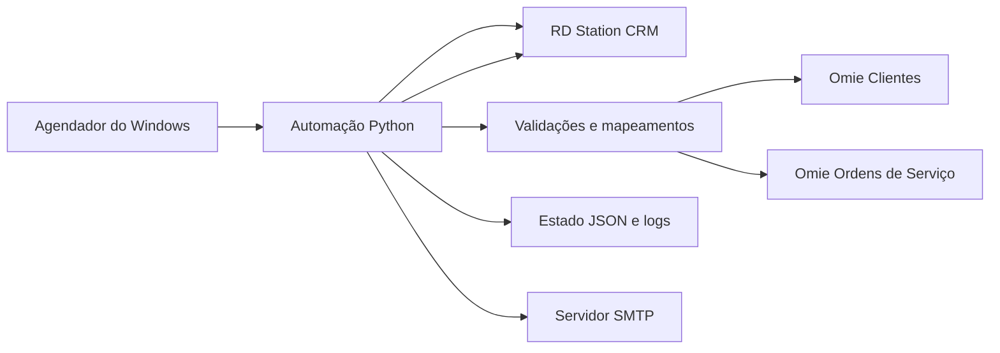
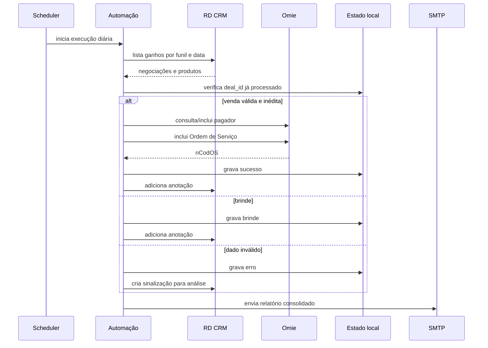

# Arquitetura e decisões técnicas

## Visão geral

A aplicação é um processo em lote, sem banco de dados obrigatório. A fonte dos
eventos comerciais é o RD Station CRM; o Omie recebe os cadastros financeiros
e as Ordens de Serviço. Arquivos JSON pequenos controlam a idempotência.

## Sequência de uma venda

## Fronteiras de responsabilidade

### Configuração

`Config.from_env()` valida o contrato do ambiente antes de acessar as APIs.
IDs e mapeamentos não ficam no código. Isso separa a implementação reutilizável
da configuração específica de cada empresa.

### Cliente de integrações

`Integrations` concentra HTTP, autenticação, timeout, limitação de chamadas,
repetição de bloqueios temporários e ações no RD. As funções de transformação
não dependem de rede e podem ser testadas isoladamente.

### Transformação e regras

Os dados do RD são convertidos para nomes canônicos. A criação da OS só ocorre
quando documento, produto, valor e forma de pagamento são reconhecidos. A
política é **fail closed**: dúvida ou ausência de mapeamento produz análise, não
um registro financeiro aproximado.

### Estado local

As gravações usam arquivo temporário seguido de `os.replace`, reduzindo o risco
de JSON parcialmente escrito. O lock exclusivo evita concorrência entre duas
instâncias no mesmo diretório.

## Idempotência

O identificador da negociação é a chave de idempotência em duas camadas:

1. `success.json` impede que uma venda concluída seja submetida novamente;
2. `cCodIntOS=RD_OS_<deal_id>` fornece um identificador estável para o Omie.

O estado local é gravado somente após o retorno positivo da criação da OS.
Brindes possuem estado separado para que possam ser distinguidos de vendas.

Em um cenário de maior volume ou múltiplos servidores, os arquivos JSON devem
ser substituídos por um banco com restrição única sobre `deal_id` e transações.

## Identidade do pagador

O código de integração do cliente deriva do CPF/CNPJ normalizado. Documentos
ausentes, com tamanho diferente de 11/14 ou formados apenas por zeros são
bloqueados. Assim, valores inválidos nunca criam um cadastro compartilhado.

Validação matemática dos dígitos verificadores pode ser adicionada conforme a
política de qualidade cadastral da instalação.

## Produtos e valores

Cada produto precisa estar em `OMIE_PRODUCT_MAP_JSON`. O valor unitário é
calculado por `total / quantidade`; quando o total não está disponível, a
rotina usa o preço unitário informado. Quantidade e valor devem ser positivos.

Se ao menos um item estiver ausente ou inválido, toda a OS é bloqueada. Isso
evita faturamento parcial de uma venda com múltiplos itens.

## Recuperação de falhas

- erros de validação ficam em `errors.json`;
- o negócio recebe uma anotação e uma tarefa de revisão no RD;
- a venda pode ser reaberta para correção;
- falhas temporárias de consumo no Omie respeitam a espera informada ou usam
  um intervalo conservador;
- o relatório diferencia sucesso, brinde, ignorado e erro;
- códigos de saída permitem monitoramento pelo Agendador.

## Observabilidade

Cada data de referência possui log próprio. O e-mail apresenta os totais e uma
linha por negócio, com o ID do RD, o `nCodOS` e a mensagem final. O mesmo
conteúdo é anexado em JSON para análise automatizada.

Dados pessoais não devem ser adicionados ao relatório além do estritamente
necessário. Em produção, recomenda-se retenção e acesso compatíveis com a LGPD.

## Evoluções possíveis

- substituir JSON por PostgreSQL ou SQLite;
- validar dígitos verificadores de CPF/CNPJ;
- adicionar métricas e alertas para observabilidade centralizada;
- criar testes de contrato com respostas anonimizadas das APIs;
- implementar uma fila de retentativas por tipo de erro;
- usar um cofre de segredos em vez de arquivo `.env`.
